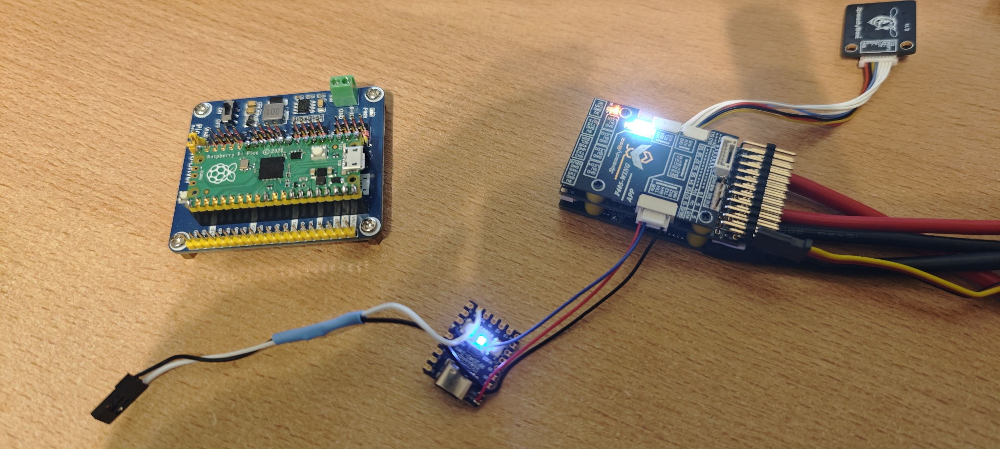
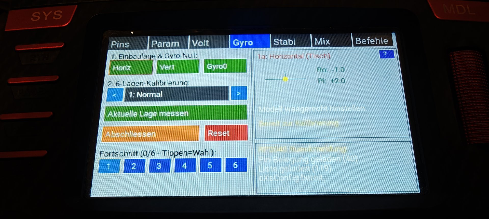
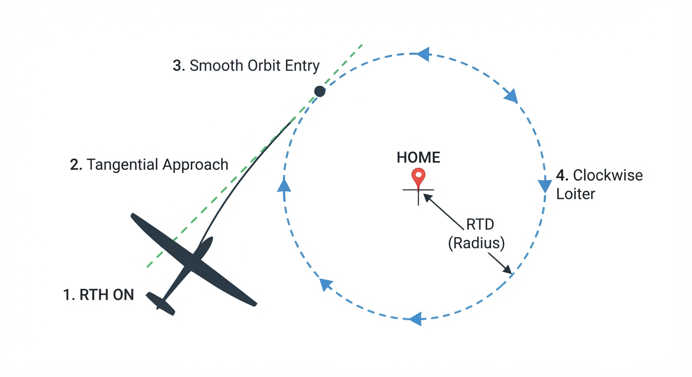

# oXs on RP2040-add-ons  
# Erweiterte Firmware & Ergänzendes

---

## Ein Multitalent im Modellbau – die Geschichte & der neue Aufbruch

Was vor vielen Jahren unter dem Namen **openXsensor (oXs)** als cleveres Selbstbau-Projekt für günstige Variometer und Telemetriesensoren begann, hat sich mit dem Wechsel auf den leistungsstarken **Raspberry Pi RP2040** zu einem echten **Multitalent für den modernen RC-Modellbau** entwickelt. Über Jahre hinweg hat **mstrens** ([Original-Repository](https://github.com)) diese Plattform mit enormem Engagement ausgebaut, verfeinert und um immer neue Sensoren und Fernsteuerprotokolle erweitert – ein riesiges Dankeschön an ihn für diese außergewöhnliche Open-Source-Grundlage!

Inzwischen wurde die Entwicklung am ursprünglichen Hauptprojekt weitgehend eingestellt. Doch die Community rund um *oXs on RP2040* ist lebendiger denn je: Gerade durch neue Ideen aus den Modellbau-Foren erfährt das System aktuell einen **spürbaren neuen Push**. Genau hier setzt dieses Repository an. Statt das Rad neu zu erfinden, greift dieser Fork die bewährte Basis auf und entwickelt sie **in klar strukturierten Einzelthemen gezielt weiter** – von der drahtlosen Konfiguration direkt über den Sender bis hin zu spezialisierten Telemetrie-Konvertern und Sicherheitsfunktionen.

### Warum oXs on RP2040 weit mehr als nur ein Sensor ist

Heute ersetzt ein einziger RP2040-Baustein (oft schon ein winziger RP2040-Zero für wenige Euro) gleich mehrere teure Einzelkomponenten im Modell:

* **16-Kanal-PWM-Empfänger-Hub & PowerBox-ähnliche Trägerplatinen:**  
  oXs dekodiert serielle Empfängersignale (ELRS/CRSF, SBUS, F.Bus, iBus, SRXL2, ExBus) und gibt bis zu **16 hochpräzise Hardware-PWM-Servokanäle** mit völlig freier Pin-Zuordnung aus. In Verbindung mit entsprechenden Trägerplatinen – ausgestattet mit Doppelstromversorgung, stabilen Hochstrom-Servoleisten und integrierten Sensoren – übernimmt das Modul die Rolle einer **kompakten PowerBox / Akkuweiche** für Großsegler, Scale-Modelle und Motormaschinen, inklusive echter Empfänger-Redundanz über einen Primär- und Sekundäreingang.
* **Integrierte 3-Achs-Gyro-Stabilisierung & Auto-Learn-Mischer:**  
  Zusammen mit einem MPU6050 arbeitet oXs als vollwertiger **3-Achs-Flugstabilisator** (Quer, Höhe, Seite) mit umschaltbaren Flugmodi (Dämpfung/Rate, Horizont-Stabilisierung/Attitude oder Aus). Ein intelligenter **Auto-Learn-Mischer** erkennt dabei selbst komplexe Flächengeometrien wie V-Leitwerke, Deltas, Flaperons oder getrennte Höhenruderservos vollautomatisch.
* **Umfangreiche Multisensor-Telemetrie für fast jedes System:**  
  Ob feinfühliges Variometer (MS5611, SPL06, BMP280), GPS-Daten, Strom- und Spannungsmessung, LiPo-Einzelzellenüberwachung (`0x0300` über ADS1115) oder Drehzahl – oXs übersetzt alle Werte nativ für **ELRS/CRSF, FrSky SmartPort & F.Bus, Jeti ExBus, Multiplex MSB, Graupner HoTT, FlySky iBus, Futaba S.BUS2 und Spektrum SRXL2**.

| Hardware | Sender-Integration (EdgeTX) |
| :---: | :---: |
|  |  |
| *RP2040-Basis & PowerBox-ähnliche Trägerplatinen* | *Drahtlose Einstellung direkt am Farbdisplay* |

---
# Die Weiterentwicklungen im Überblick

| Thema & Projekt | Vorschau (Klick für Details) | Schwerpunkt & Funktion |
| :--- | :---: | :--- |
| **EdgeTX Lua Configurator** *(Coming soon)* |  | Pins, Spannungen, Gyro-Werte & 6-Lagen-Kalibrierung **drahtlos am Sender** einstellen (CRSF, FrSky S.Port & F.Bus). || **[FrSky S.Port Telemetrie-Konverter](https://github.com/Networker-001/FRSKY-S.Port-Telemetrie-Converter)** & **[INAV LTM Konverter](INAV%20Konverter.md)** |  | Übersetzt **FrSky S.Port** oder **INAV LTM** für Jeti ExBus, Multiplex MSB, CRSF und HoTT (eigenes Doku-Repository). |
| **[Return to Home (RTH)](oxs.md)** |  | GPS-gestützte Rückkehrfunktion direkt auf dem RP2040 ohne separaten Flightcontroller. |
| **[Funktionelle Erweiterungen](oxs.md)** |  | Laufend neue Funktionen, FrSky `0x0300`-Einzelzellen & zweispaltige 30-GPIO-Übersicht (`PIN=?`) im Terminal. |

---

## Community & Austausch

* **RC-Network Diskussionsthread:** [oXs-on-RP2040 Hauptthread (Erfahrungsaustausch & Neuigkeiten)](https://rc-network.de)
* **Ursprüngliches Basisprojekt:** [mstrens/oXs_on_RP2040 auf GitHub](https://github.com)
